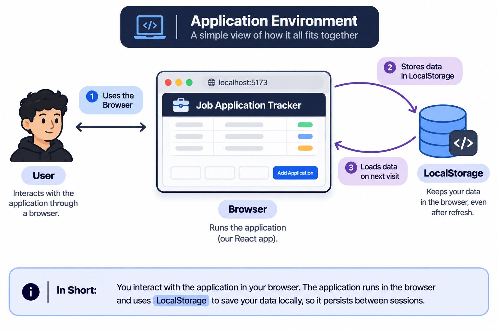

# Job Application Tracker

A client-side web application built with React to manage and track job applications. It allows users to create, view, update application statuses, and delete application records.

This project was built as a hands-on exercise to understand React fundamentals, component communication, state management, CRUD operations, and browser-based data persistence.

## Features

- **Add Applications:** Create new job application records with details such as company, position, application date, salary, and contact information.
- **View Applications:** Display saved applications in a structured table.
- **Update Status:** Change an application's status directly from the dashboard.
- **Delete Applications:** Remove individual application records.
- **Empty State:** Display an appropriate message when there are no applications.
- **Data Persistence:** Retain application records across browser refreshes using the browser's LocalStorage API.

## Application Environment

The application runs entirely in the user's web browser. React manages the application interface and state, while LocalStorage is used to save and retrieve application data.



## Tech Stack

- **Frontend:** React
- **Language:** JavaScript (ES6+)
- **Build Tool:** Vite
- **Styling:** Tailwind CSS
- **Browser Storage:** LocalStorage

## Getting Started

### Prerequisites

- Node.js
- npm

### Installation

Clone the repository:

```bash
git clone https://github.com/Horizon783/job-application-tracker.git
```

Navigate to the project directory:

```bash
cd job-application-tracker
```

Install dependencies:

```bash
npm install
```

Start the development server:

```bash
npm run dev
```

Open the local URL displayed in your terminal to access the application.

### Production Build

To generate a production build:

```bash
npm run build
```

To run the project's lint checks:

```bash
npm run lint
```

## How It Works

The application uses React state to manage job application records.

- **App:** Acts as the source of truth for the job applications state and handles operations such as adding, updating, and deleting records.
- **Dashboard:** Receives application data and callback functions through props. It displays the records and allows users to update statuses or delete applications.
- **InputJob:** Manages form inputs using React state and submits new application records to the parent component through a callback.

### Data Persistence

The application uses React's `useState` and `useEffect` hooks alongside the browser's LocalStorage API.

- Lazy initialization retrieves previously saved application records when the application initializes.
- `useEffect` synchronizes changes in the applications state with LocalStorage.
- `JSON.stringify()` and `JSON.parse()` are used to serialize and deserialize application data.


## Limitations & Known Issues

### Limitations

The application currently operates entirely on the client side.
Some limitations of this approach are:

- **Local data only:** Job applications are stored in browser
  LocalStorage and are not synchronized across devices.
- **No user accounts:** The application does not implement
  authentication or user-specific data isolation.
- **No external database:** Data is not stored in a centralized
  database or backend server.
- **Browser dependency:** Clearing the browser's stored data
  will remove the saved applications.

### Known Issues

Known bugs and issues that have not yet been resolved will be
documented here.

Currently, no additional confirmed issues are documented.

## Potential Improvements

- Introduce a backend using Node.js and Express.
- Integrate PostgreSQL for persistent database storage.
- Implement user authentication and authorization.
- Add search, filtering, and sorting capabilities.
- Introduce automated testing.

## Learning Objectives

This project provides practical experience with:

- Building component-based interfaces using React.
- Managing state and passing data through props.
- Handling forms and controlled inputs.
- Implementing immutable state updates using JavaScript array methods.
- Synchronizing React state with browser storage.
- Structuring and documenting a frontend application.


## Implementation Notes & Concepts

This section explains some of the React and JavaScript concepts
used to implement the application.

### 1. Lazy Initialization with useState

The application uses lazy initialization to retrieve previously
saved job applications from LocalStorage.

Instead of passing the result of a function directly to useState,
a function is passed as the initializer.

This allows the initialization logic to run when React initializes
the state, rather than evaluating the LocalStorage read on every
component render.

```jsx
const [jobs, setJobs] = useState(() => {
    const stored = localStorage.getItem("JobApplications");
    return stored ? JSON.parse(stored) : data;
});
```

**Further reading:**
- [React useState documentation](https://react.dev/reference/react/useState)
- [React useState: Lazy Initialization — DEV Community](https://dev.to/davidecannerozzi/react-usestate-lazy-initialization-a-complete-guide-1bck)

### 2. Synchronizing State with useEffect

The application uses useEffect to synchronize changes in the
jobs state with LocalStorage.

```jsx
useEffect(() => {
    localStorage.setItem("JobApplications", JSON.stringify(jobs));
}, [jobs]);
```

Whenever the jobs state changes, the Effect runs and saves the
updated collection to LocalStorage.

### 3. Managing Shared State

The App component owns the jobs state because both Dashboard
and InputJob need to interact with the same collection.

Dashboard receives the data and update callbacks through props,
while InputJob receives a callback to submit new applications.

This keeps a single source of truth for application records.
